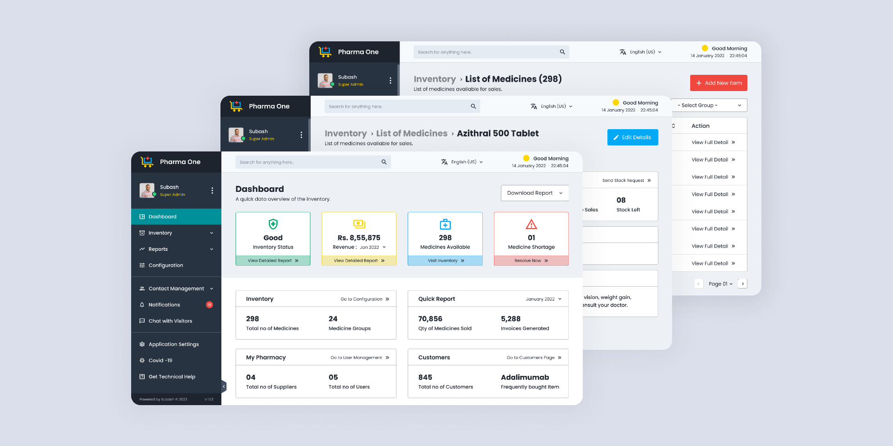

# Pharma One — Design System

> **Source:** Visual analysis of the user-provided Pharma One dashboard composition (1920 × 960 px).
> **Scope:** Screenshot-derived UI design specification for implementation by AI coding agents.
> **Evidence levels:** **Observed** means directly visible or color-sampled from the screenshot; **Estimated** means inferred from visible pixels; **Proposed** means an implementation rule added where a static screenshot cannot establish the original CSS or behavior.
> **Important:** The image is a *marketing-style composition of three overlapping application screens*. Do **not** implement overlapping browser panels in the product UI. Implement the Dashboard, Medicine Detail, and Medicine Inventory as three separate views sharing one design system.



## 1. Visual Theme & Atmosphere

Pharma One is a compact, light-mode, data-oriented **pharmacy inventory administration interface**. Its character is practical, orderly, and approachable: employees should be able to scan stock health, revenue, shortages, inventory listings, and common actions without visual distraction.

The visual language pairs a **dark navy vertical sidebar** with a **cool, pale gray-blue application canvas**. White cards, thin neutral borders, compact typography, and a restrained teal active state create a utilitarian enterprise-dashboard feel. Colorful summary cards encode *meaning*, not decoration: green for healthy inventory, yellow for revenue, cyan/blue for available medicine, and coral/red for shortages or risk.

### Key Characteristics

- **Observed:** A persistent, dark two-tone sidebar with white labels and small outline icons.
- **Observed:** Teal background behind the currently selected sidebar destination.
- **Observed:** Light gray-blue app background with white inner content panels.
- **Observed:** Four horizontal, outlined metric cards, each with a colored lower action band.
- **Observed:** Two-column lower dashboard modules with subtle gray outlines and header separators.
- **Observed:** Narrow utility top bar with search, language selector, and greeting/date/time cluster.
- **Observed:** Breadcrumb-like page title hierarchy on inventory and detail screens.
- **Observed:** Compact tables, slim filters, text actions, and understated pagination.

**Composition caveat:** The soft slate-lavender backdrop (`#DBDFEB`) belongs to the *presentation image*, not the app canvas. Likewise, the large shadows cast by the three overlapping screens are composition effects, not normal dashboard card shadows.

**Reference screen inventory:**

1. **Dashboard (foreground):** dark sidebar, toolbar, page title, report dropdown, four KPI cards, two-column information modules.
2. **Medicine Detail (middle):** `Inventory › List of Medicines › Azithral 500 Tablet` breadcrumb, blue `Edit Details` action, medication information, stock details.
3. **Medicine Inventory (background):** `Inventory › List of Medicines (298)` heading, red `Add New Item` action, filter dropdown, table action links, pager.

## 2. Color Palette & Roles

The dominant palette is **navy + icy light gray + white**, with **teal** reserved for selected navigation and **semantic accent colors** for domain-specific KPI cards. Hex values below were sampled from visible screenshot pixels when marked *Observed*. The screenshot provides no original stylesheet, so these are **reference colors rather than a recovered brand token file**.

### Primary

| Hex | Role | Where seen / usage | Evidence |
| --- | --- | --- | --- |
| `#1D242E` | Sidebar masthead; strongest dark neutral | Branding strip, primary text on light surfaces | Observed |
| `#283342` | Sidebar navigation surface | Profile panel, sidebar menu background | Observed |
| `#009099` | Active navigation / teal accent | Selected `Dashboard` row | Observed |
| `#FFFFFF` | Card and main panel surface | KPI cards, report modules, table rows | Observed |

### Accent

| Hex | Role | Where seen / usage | Evidence |
| --- | --- | --- | --- |
| `#03A9F5` | Action blue / info | `Edit Details` button, medicine metric icon | Observed |
| `#F0483E` | High-prominence create CTA | Red `Add New Item` button, approximate flat-area match | Estimated |
| `#FED600` | Yellow brand highlight / notification | Header status dot, small logo/cart highlights | Observed |
| `#FFFFFF` | Text on saturated actions | Blue, coral, and teal buttons | Observed |

### Semantic

| Hex | Role | Where seen / usage | Evidence |
| --- | --- | --- | --- |
| `#01A768` | Success foreground / icon | Good inventory status | Observed |
| `#A6DBCB` | Success action-strip fill | Green KPI card footer | Observed |
| `#80D3B3` | Success outline | Green KPI card border | Observed |
| `#FED600` | Revenue / yellow KPI icon | Revenue summary illustration | Observed |
| `#F2E9AC` | Revenue action-strip fill | Yellow KPI card footer | Observed |
| `#03A9F5` | Information foreground / icon | Medicine availability KPI | Observed |
| `#A7DBF5` | Information action-strip fill | Blue KPI card footer | Observed |
| `#F04A46` | Danger / alert foreground | Shortage warning illustration; approximate | Estimated |
| `#EEBEBE` | Danger action-strip fill | Red KPI card footer | Observed |
| `#F7A39E` | Danger outline | Red KPI card border | Observed |

**Semantic use:** Four KPI categories in the screenshot are **success / revenue / inventory / shortage**. Do not interpret yellow revenue as a warning or use red shortage as a decorative highlight. Background bands should remain lighter than their corresponding icons.

### Surfaces

| Hex | Role | Where seen / usage | Evidence |
| --- | --- | --- | --- |
| `#EDF1F5` | Main application canvas | Dashboard background outside white cards | Observed |
| `#F7FAFD` | Utility header surface | Top toolbar | Observed |
| `#E3EBF3` | Search field background | Toolbar search box | Observed |
| `#FFFFFF` | Elevated paper/card surface | Dashboard panels, filters, tables, modal-like detail blocks | Observed |
| `#DBDFEB` | Reference presentation backdrop **only** | Outside the composited screens | Observed |

### Borders

| Hex | Role | Where seen / usage | Evidence |
| --- | --- | --- | --- |
| `#DDDEDF` | Default neutral panel outline | Report modules, card dividers, table structure | Observed |
| `#505965` | Navy sidebar separation | Subtle sidebar rule / group separator | Observed |
| `#9399A0` | Muted secondary details | De-emphasized metadata / hint treatment | Estimated |

### Shadows

No original shadow CSS can be recovered from a single static image. The product UI has **little visible card shadow**; borders do most of the separation. The strong shadow around each stacked dashboard window is **not** a component shadow and should not be applied to ordinary cards.

### Notes

- Use **navy for the shell**, **teal for current location**, **blue for editing**, and **coral for creation and important actions**, following the depicted contexts.
- Do not recolor the entire interface in bright blue: saturated colors occupy only a small proportion of the visible surface.
- Keep metric card bodies white. Put their semantic fill in the **thin bottom CTA strip**, with a related colored border/icon.
- Keep body copy in dark navy and supporting copy in a less prominent cool-gray text color.
- The screenshot demonstrates **light UI with a dark sidebar**, not a globally dark UI.

**Implementation-ready starter tokens (color values only; palette derived from screenshot):**

```css
:root {
  --color-ink: #1D242E;
  --color-sidebar: #283342;
  --color-sidebar-brand: #1D242E;
  --color-nav-active: #009099;
  --color-canvas: #EDF1F5;
  --color-toolbar: #F7FAFD;
  --color-field: #E3EBF3;
  --color-surface: #FFFFFF;
  --color-border: #DDDEDF;
  --color-muted: #9399A0;
  --color-action-blue: #03A9F5;
  --color-action-create: #F0483E;
  --color-brand-yellow: #FED600;
  --color-success: #01A768;
  --color-success-soft: #A6DBCB;
  --color-revenue-soft: #F2E9AC;
  --color-info-soft: #A7DBF5;
  --color-danger: #F04A46;
  --color-danger-soft: #EEBEBE;
}
```

## 3. Typography Rules

**Observed style:** compact geometric sans-serif with circular letterforms, single-level hierarchy, relatively bold headings and stat values, and smaller muted captions. **Font identification is not verifiable from the image**; **Poppins** is the closest practical candidate, with **Inter** or a system sans-serif as a fallback. Avoid claiming an original licensed font or font file was identified.

### Hierarchy

The sizes below are **estimated target implementation sizes** for a full-size desktop interface. They are not extracted computed styles: the input image depicts rescaled, layered screenshots.

| Role | Font | Size | Weight | Line height | Letter spacing | Evidence |
| --- | --- | --- | --- | --- | --- | --- |
| Display / KPI value | Poppins, sans-serif | 22–24px | 700 | 1.2 | `-0.02em` | Estimated |
| H1 / page heading | Poppins, sans-serif | 22px | 650–700 | 1.3 | `-0.015em` | Estimated |
| H2 / section title | Poppins, sans-serif | 17–18px | 600–700 | 1.35 | `-0.01em` | Estimated |
| H3 / panel heading | Poppins, sans-serif | 14–15px | 600 | 1.4 | `0` | Estimated |
| Body / navigation | Poppins, sans-serif | 13–14px | 400–500 | 1.5 | `0` | Estimated |
| Small / metadata | Poppins, sans-serif | 11–12px | 400–500 | 1.45 | `0` | Estimated |
| Mono / numerical alignment | ui-monospace, monospace | 12–13px | 500 | 1.4 | `0` | Proposed for long IDs / tabular figures; not shown as a separate font |

### Principles

- Page headings and metric values are noticeably bolder than labels; **number-first hierarchy** is essential.
- Smaller captions remain readable; for a production implementation prefer `12px+` for secondary information rather than reproducing unreadably tiny text from the reduced composite image.
- Breadcrumbs use **subtle preceding segments** and a **strong, dark current segment**.
- Avoid wide display typography, all-uppercase labels, or editorial-style hero text: this is an operational tool.
- Align numerals inside metric groups and table columns predictably. `font-variant-numeric: tabular-nums` is a **proposed enhancement** for live values.
- Side navigation text should be lighter-weight than section headings; selected location should be indicated by background first, text color second.

## 4. Component Stylings

### Buttons

| Variant | Background | Text / icon | Border | Shape and spacing | Interaction guidance |
| --- | --- | --- | --- | --- | --- |
| **Primary create** | `#F0483E` | White, plus icon at leading edge | None visible | Rectangular, subtly rounded, compact horizontal padding | Slight darkening on hover (**proposed**) |
| **Primary edit** | `#03A9F5` | White, pencil icon at leading edge | None visible | Rectangular, subtly rounded | Slight darkening on hover (**proposed**) |
| **Secondary dropdown** | White | Dark navy and downward chevron | `1px solid #DDDEDF` | Thin rectangle, little rounding | Border emphasis on hover (**proposed**) |
| **Ghost/text action** | Transparent | Dark navy / contextual accent | None | Minimal padding | Underline or stronger text contrast on hover (**proposed**) |
| **Destructive** | Danger red (if needed) | White | None | Same footprint as primary | Confirmation before destructive actions (**proposed; not shown**) |

Buttons in the reference feel *small and functional*, not large, pill-shaped marketing CTAs. Use icon-and-label pairings for the clearly visible actions: `+ Add New Item`, `Edit Details`, `Download Report`.

### Cards

- **KPI cards:** white center, visible `1px` category-colored outline, compact icon at top, bold value/title in the middle, caption below, **full-width pastel footer action strip** at bottom. Near-square corners or a very small radius. Four equally sized cards form one horizontal row in the pictured foreground view.
- **Information panels:** white background, subtle neutral outline, title row separated by a horizontal divider, metrics organized in two columns beneath; minimal/no shadow.
- **Detail content panels:** white boxed groupings for medicine data and small stock metric groups; consistent gray borders and quiet separation.
- **Empty/loading/error states:** not visible in source; if implemented, use the same canvas/surface language and semantic colors without introducing illustrations that dominate the dashboard.

### Inputs

- Search uses a **light blue-gray fill** (`#E3EBF3`) on the top toolbar, with an unobtrusive search icon at the right edge.
- The text placeholder is lighter than entered text. No strong default border is visible.
- Category/group filtering uses a **white, bordered, low-radius select control**.
- **Proposed accessible focus treatment:** a visible `2px` teal/blue focus outline, adequate offset, and matching `:focus-visible` styles for keyboard users. Exact focus style is **not observable** in a screenshot.

### Navigation

- **Brand row:** deep navy `#1D242E`, compact medical/cart-like symbol in yellow/blue/red, bold white text `Pharma One`.
- **Profile block:** muted navy `#283342`, small avatar, user display name, bright status dot and highlighted role `Super Admin`, overflow menu.
- **Menu block:** dark navy, white labels, small outline icons, understated chevrons on expandable sections.
- **Active destination:** full-width teal `#009099` row. Avoid turning only the text teal; the screenshot uses a **filled active strip**.
- **Groups:** Dashboard, Inventory, Reports, Configuration, Contact Management, Notifications, Chat with Visitors, Application Settings, Covid-19, Get Technical Help.
- **Sidebar dividers:** thin cool-gray-on-navy separators between menu clusters.
- **Footer:** tiny, low-emphasis powered-by/version metadata at the bottom.
- **Top toolbar:** left search, middle/right language selector, far-right yellow dot + greeting + date and digital clock.

### Image Treatment

The product interface contains **almost no photographic content**: a small square profile avatar is the major exception. Keep the avatar compact, square-ish, and subtly rounded; preserve clarity at small sizes. The pharmacy cart/medical cross logo should use a clean icon or SVG, not a raster hero image. The large blurred background in the supplied reference is part of the external marketing composition, not an asset needed inside the app.

### Distinctive Components

1. **Semantic Metric Tile:** icon → big figure/title → short context label → tinted full-width action footer. The four tile colors communicate four categories and must preserve their relationship across screens.
2. **Dual-Metric Report Panel:** boxed white module with text title on left, link on right, thin divider, and two summary metrics below. Foreground dashboard examples: `Inventory`, `Quick Report`, `My Pharmacy`, `Customers`.
3. **Breadcrumb Title Block:** dim previous steps, bold current page; secondary one-line description underneath (e.g., `List of medicines available for sales.`).
4. **Inventory Table Action Column:** repeating `View Full Detail »` links, thin row dividers, simple dropdown filter and pager. Keep it scannable rather than styling every action as a button.
5. **Compact Toolbar Status:** small yellow status dot over/alongside `Good Morning`, with date and time in smaller typography. Date/time values are dynamic, not immutable visual content.

### Screen-Level Anatomy

**Dashboard:**

```text
┌──────────────── Sidebar ────────────────┬────────────────── Main application ──────────────────────┐
│ Brand / user / menu                     │ Search          Language       Greeting + date/time     │
│                                        ├─────────────────────────────────────────────────────────┤
│ Dashboard  ← active                    │ Dashboard                                Download Report  │
│ Inventory / Reports / ...              │ A quick data overview of the inventory.                 │
│                                        │ [Good] [Revenue] [Medicines] [Shortage]                │
│                                        │ ┌ Inventory ──────┐  ┌ Quick Report ───┐                │
│                                        │ │ 2 statistics   │  │ 2 statistics    │                │
│                                        │ └────────────────┘  └─────────────────┘                │
│                                        │ ┌ My Pharmacy ───┐  ┌ Customers ───────┐                │
│                                        │ │ 2 statistics   │  │ 2 statistics    │                │
│                                        │ └────────────────┘  └─────────────────┘                │
└────────────────────────────────────────┴─────────────────────────────────────────────────────────┘
```

**Medicine Inventory:** sidebar + shared toolbar + breadcrumb/heading `Inventory › List of Medicines (298)` + subtitle + red create action + group filter + table + link-style row actions + pagination.

**Medicine Detail:** sidebar + shared toolbar + breadcrumb `Inventory › List of Medicines › [medicine name]` + subtitle + blue edit action + medicine details and stock metrics.

## 5. Layout Principles

### Spacing Scale

The reference uses a **tight administrative density**, with comparatively little empty space between structured elements. Exact original spacing cannot be recovered from the rescaled marketing composition. A **proposed** 4px-based spacing system compatible with the visible rhythm is:

`4 / 8 / 12 / 16 / 20 / 24 / 32px`

Suggested token roles: `4px` micro-gap; `8px` icon-to-label and control spacing; `12px` compact cells; `16px` typical card inner padding; `20–24px` section gutters; `32px` between major page regions where space allows. **These are suggested implementation tokens, not confirmed source CSS.**

### Grid

- **Observed:** left sidebar + right application column, with toolbar above content.
- **Observed:** four-across summary card row on Dashboard; lower panels in **two equal columns**.
- **Observed:** tables and dropdowns stretch across the main application region on the Inventory screen.
- **Proposed desktop shell:** `sidebar: 224–240px`, main region `minmax(0, 1fr)`; toolbar height about `56–64px`.
- **Proposed content gutter:** `24px` at regular desktop widths, decreasing to `16px` on narrow widths.
- **Proposed KPI grid:** `repeat(4, minmax(0, 1fr))` at ample widths, without forcing overflow on smaller screens.
- **Proposed report grid:** `repeat(2, minmax(0, 1fr))` at tablet/desktop widths.
- Keep metric cards the same height and use a consistent baseline for icon, number, label, and footer.

### Whitespace

The interface **prioritizes information density** over airy marketing-page spacing. Whitespace is used to separate the dashboard shell, page header, top metrics, and lower modules; borders then delineate individual blocks. Avoid giant gaps, floating decorative elements, or wide center-aligned content on admin pages.

### Radius Scale

The visible panels and controls appear mostly squared-off or **very slightly rounded**. Since the exact radius is not recoverable, use the following **proposed** implementation scheme:

| Token | Value | Usage |
| --- | --- | --- |
| `radius-xs` | `2px` | Table filters, slim controls |
| `radius-sm` | `4px` | Buttons, KPI cards, panel borders |
| `radius-md` | `6px` | Search and dropdown menus |
| `radius-lg` | `10px` | Optional overlay/dialog only |
| `radius-pill` | `999px` | Tiny presence/status dot only |

Do not apply large `16–24px` rounded corners to every data module; doing so would noticeably depart from the source.

## 6. Depth & Elevation

### Levels

The following **proposed** CSS is tuned to approximate the restrained depth visible in the application, **not recovered from original HTML/CSS**.

| Level | Use | Shadow | Evidence |
| --- | --- | --- | --- |
| 0 | Flat dashboard surfaces, KPI cards, data panels | `none` | Observed flat/bordered presentation |
| 1 | Dropdown/popover resting | `0 2px 8px rgba(29,36,46,0.08)` | Proposed |
| 2 | Floating menus, hover overlays | `0 6px 18px rgba(29,36,46,0.12)` | Proposed |
| 3 | Modal/dialog overlays | `0 14px 36px rgba(29,36,46,0.16)` | Proposed |

### Philosophy

Prefer **contrast + outlines + whitespace** to elevation as the default separator. White cards should sit cleanly on `#EDF1F5` without looking detached. Reserve greater elevation for truly floating UI. The three overlapping frames in the reference image use pronounced composition shadows solely to signal depth in the illustration; do **not** carry that effect into ordinary app screens.

## 7. Interaction & Motion

The reference is a static image. No hover, click, loading, keyboard, or animated behavior can be observed, so every specific behavior and duration below is **proposed**.

### Hover States

- **Sidebar row:** change from base navy to a slightly lighter navy; selected row stays teal regardless of hover.
- **Primary action:** darken the button color slightly; preserve white icon and label.
- **Text action:** strengthen navy/teal contrast or underline the label; avoid shifting table rows.
- **KPI footer:** modest saturation or brightness adjustment; preserve its semantic color.
- **Data row:** very subtle cool-gray hover background, not a dramatic elevation effect.

### Focus States

Provide keyboard-visible `:focus-visible` styles on navigation items, selects, buttons, pagination, and text links. **Proposed:** 2px focus outline in `#03A9F5` with 2px offset, or a high-contrast teal alternative. Respect WCAG contrast and ensure selected state is not identified only by color where labels/icons can assist.

### Transitions

- **Proposed:** `color`, `background-color`, and `border-color`: `150ms ease-out`.
- **Proposed:** dropdown appearance: `150–180ms ease-out`, small fade/translate; do not animate the layout width.
- **Proposed:** sidebar mobile drawer: `180–220ms ease-out`.
- Avoid bounce, large-scale zooms, glassmorphism, continuous pulses, and dashboard number-counting effects unless they solve a functional need.
- Respect `prefers-reduced-motion: reduce` and disable nonessential movement.

### Behavior Contract

- Sidebar entries navigate or expand; do not treat every row as an independent route when a chevron indicates a nested section.
- Search and filtering must operate on domain data; placeholders and screenshots are not functionality.
- `Download Report`, `Add New Item`, `Edit Details`, and pagination must have working states, permission checks, and empty/error handling.
- Status, medicine count, revenue, user counts, and date/time are **sample data in the image**, not fixed design tokens.

## 8. Responsive Behavior

**Observed:** only desktop-style overlapping compositions. **No actual responsive screenshots or media queries are provided.** The breakpoints and behavior below are **proposed**, not claims about the original project.

### Breakpoints

| Name | Min width | Primary change | Evidence |
| --- | --- | --- | --- |
| `base` | `0px` | Drawer sidebar, one KPI column, stacked content modules, compact header | Proposed |
| `sm` | `640px` | Two KPI columns if legible; keep sidebar in drawer | Proposed |
| `md` | `768px` | Two report-panel columns and improved header distribution | Proposed |
| `lg` | `1024px` | Persistent left sidebar, desktop utility toolbar | Proposed |
| `xl` | `1280px` | Four KPI columns with comfortable card width and regular content gutters | Proposed |

### Touch Targets

**Proposed:** clickable targets should be at least `44 × 44px` on touch-first layouts when practical. Compact table actions may appear smaller visually, but their clickable areas should be padded to remain usable.

### Collapsing Strategy

- **Mobile:** replace fixed sidebar with a toggleable drawer; put the brand mark/name in the header or drawer title.
- **Mobile:** keep search accessible and collapse secondary toolbar metadata before shrinking primary actions beyond legibility.
- **Tablet:** use two KPI columns and two or one lower information-panel columns according to available width.
- **Desktop:** expose four metrics in one row, two-column report modules, and a persistent sidebar.
- **Tables:** preserve field labels and usable row actions; use horizontal overflow or a purpose-built stacked row view rather than clipping columns.
- **Breadcrumbs:** truncate earlier parts before the current page title; retain accessible full labels.

### Image Behavior

The avatar should maintain a square crop (`object-fit: cover`) at every viewport. Brand icons should retain their line weight and proportions. There is no responsive product hero image in the visible interface; do not introduce one simply because the reference picture has a large presentation canvas.

## 9. Agent Prompt Guide

This document is the **single visual source of truth** for generating a Pharma One-style admin interface. Read the **observed rules** first. Use **estimated/proposed rules** only when direct evidence is unavailable; adjust them if a higher-fidelity reference or actual application styles are later supplied.

### Quick Color Reference

```text
#1D242E  sidebar-brand / text-primary
#283342  sidebar-background
#009099  navigation-active
#EDF1F5  dashboard-canvas
#F7FAFD  toolbar
#E3EBF3  search-field
#FFFFFF  card-surface
#DDDEDF  border-neutral
#03A9F5  edit / info-action
#F0483E  create-action (estimated)
#01A768  healthy-state
#FED600  yellow-brand / revenue icon
#A6DBCB  success-footer
#F2E9AC  revenue-footer
#A7DBF5  info-footer
#EEBEBE  shortage-footer
```

### Example Prompts

**Prompt A — Dashboard recreation:**

> Read `design.md` and `images/pharma-one-reference.png`. Build the Pharma One Dashboard as a single real application page, **not** the overlapping marketing composition. Keep the navy `#283342` sidebar, teal `#009099` active item, light `#EDF1F5` main canvas, compact header, four semantic outlined KPI cards with colored footer strips, and the four two-metric modules in a two-column grid. Use reusable components and design tokens; do not invent gradients or oversized rounded cards.

**Prompt B — Inventory module:**

> Using the shared Pharma One shell specified in `design.md`, implement an inventory listing with breadcrumbs, `List of Medicines` heading, compact description, coral `Add New Item` button, group dropdown, data table, text-style `View Full Detail` actions, and pagination. Preserve neutral row dividers, dark-navy text, compact Poppins-like typography, and an accessible responsive table behavior.

**Prompt C — Medicine details:**

> Extend the same shell to a Medicine Detail view. Show breadcrumb `Inventory › List of Medicines › [medicine]`, a blue `Edit Details` button, medicine information sections, and stock data in clean white bordered modules. Use existing CSS variables, shallow elevation, and the existing responsive sidebar. Do not introduce a separate visual theme for this view.

### Iteration Guide

1. **Preserve shell identity first:** navy sidebar, filled teal active row, pale application background, and white content panels must remain consistent between routes.
2. **Preserve data density:** if the UI feels too spacious, reduce section gaps before shrinking text to illegible sizes.
3. **Preserve semantic encoding:** success stays green, revenue stays yellow, medicines stay cyan/blue, shortage stays coral/red. Keep their footer bands pastel.
4. **Keep shapes restrained:** if cards start looking like consumer-app tiles, reduce radius and shadow; bring back thin outlines.
5. **Use reusable primitives:** `AppShell`, `Sidebar`, `UtilityToolbar`, `PageHeading`, `KpiCard`, `SummaryPanel`, `MedicineTable`, and `Pagination` should share tokens across pages.
6. **Validate against the source:** compare the rendered desktop Dashboard side by side with the foreground window in the screenshot. Evaluate silhouette, relative widths, tile rhythm, contrast, font weight, and panel density before polishing micro-details.

### Mandatory Do / Don't Rules for Agents

- **DO** treat the image as a visual reference, not as an instruction to render three overlapping screens.
- **DO** implement actual routes/pages for Dashboard, Medicine Detail, and Medicine Inventory.
- **DO** preserve the small, utilitarian, blue/teal/navy-oriented enterprise look.
- **DO** use accessible labels, real focus states, responsive reflow, and dynamic data.
- **DON'T** replace navy with purple, use large pastel gradients, add glassmorphism, or inflate every component's border radius.
- **DON'T** place semantic KPI colors on the whole app background.
- **DON'T** claim estimated font families, breakpoints, shadows, and motion values were extracted from source CSS.
- **DON'T** hard-code screenshot-only dates, user names, counts, currency amounts, or medicines as global design rules.

### Acceptance Checklist

- [ ] Dark left sidebar with correct visual grouping and teal selected state.
- [ ] Light utility toolbar with search, language, and status/date cluster.
- [ ] Dashboard page heading and unobtrusive report action.
- [ ] Four equal-weight semantic KPI cards with icon, prominent figure, caption, pastel footer.
- [ ] Two-column lower information panels with thin borders and divided headers.
- [ ] Inventory list and medicine detail pages reuse the same shell and components.
- [ ] Typography is compact and approximately Poppins-like, with legible fallback.
- [ ] Mobile and tablet reflow avoids sidebar/table overflow.
- [ ] Focus, hover, keyboard and reduced-motion experiences work.
- [ ] No overlapping screenshot-window effect appears in the real application.

---

**Provenance and limitations:** The evidence is a **single uploaded raster screenshot**, not access to the original live website, HTML, or CSS. Directly sampled color values are comparatively reliable, while typography metrics, sizing, states, motion, and responsive rules are explicitly marked as estimates or implementation proposals. The reference image is preserved in `images/pharma-one-reference.png`.
